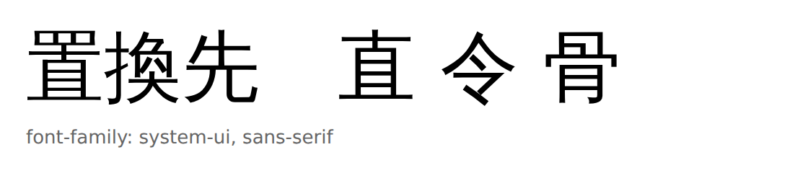
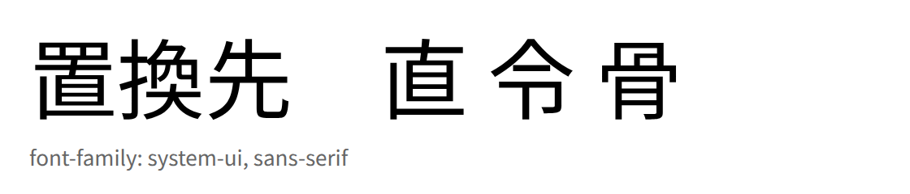

# WSL の Chromium / Playwright で日本語が中国語フォントにフォールバックする

Last reviewed: 2026-10-24

適用先: WSL2（Ubuntu）上の Chromium 系ツール。fontconfig を使うもの全般（playwright-cli、Chrome / Chrome for Testing、Electron アプリ）

実環境への適用は workstation-config の `home/dot_config/fontconfig/fonts.conf` で管理している（[fontconfig: Chromium の CJK フォールバックを日本語字形に固定する #226](https://github.com/u7chan/workstation-config/pull/226)）。

## 概要

WSL の Chromium で日本語ページをスクリーンショットすると、漢字の一部が中国語向けの字形で描画される。原因は `fonts-wqy-zenhei` が入れる `/etc/fonts/conf.d/64-wqy-zenhei.conf` が、generic family（`serif` / `sans-serif` / `monospace`）の先頭に中国語フォント WenQuanYi Zen Hei を挿していること。

`~/.config/fontconfig/fonts.conf` の `prefer` で generic family の並びを上書きし、WenQuanYi Zen Hei より前に日本語フォント（Noto Sans / Serif CJK JP）を置くと解消する。`fonts-noto-cjk` をインストールするのは、この `prefer` 先の実体を用意するため。インストールだけでは直らない。

`LANG` を日本語ロケールにしても、ページの HTML に `lang="ja"` を書いても、`lang=ja` を条件にした fontconfig ルールでも直らない（すべて実測で効果なし）。この環境の Chrome for Testing 152 では、`lang=ja` を条件にしたルールが CJK フォールバックに効かなかった。Skia の fontconfig backend は BCP-47 から `FC_LANG` を立てる実装があり、Chromium の経路しだいで変わる部分なので、generic family の並び順を固定する方が確実。

## 症状

日本語のページなのに、特定の漢字だけ中国語の字形になる。





気づいたきっかけは「置換先」の `置` が中国語字形になっていたこと。字形の違いはこのあたりで判別できる。

| 字 | 中国語フォント（WenQuanYi Zen Hei） | 日本語フォント |
| --- | --- | --- |
| 置 | 上部の `罒` が横線の詰まった箱に見える | `罒` の縦画 2 本が見える |
| 直 | 下端の横画が左右に突き抜ける | 下端が内側に収まる |
| 令 | 最終画が長く左下へ伸びる（マ形） | 最終画が短い点になる |
| 骨 | 上部の内側の箱が右上寄り | 上部の内側の箱が中央 |

`骨` `次` `海` なども形が変わる。`直` と `令` を見れば一目で分かる。

## 確認環境

| 項目 | 内容 |
| --- | --- |
| OS | Windows 11 ホストの WSL2（Ubuntu 26.04.1 LTS、kernel 6.18.54.1-microsoft-standard-WSL2） |
| ブラウザ | Chrome for Testing 152.0.7977.8（playwright-cli 0.1.18 / playwright-core 1.63.0-alpha が使う `chromium-1237`） |
| fontconfig | 2.17.1-3ubuntu1 |
| 日本語フォント | `fonts-ipafont-gothic` 00303-23ubuntu1 のみ |
| 中国語フォント | `fonts-wqy-zenhei` 0.9.45-8build1 |
| fonts-noto-cjk | 未インストール（検証時に `apt-get download` して一時展開） |
| ロケール | `LANG=C.UTF-8` |

```console
$ fc-list :lang=ja | wc -l
10
```

内訳は IPA フォント、WenQuanYi Zen Hei、Unifont とその派生。Noto CJK は入っていない。

## 原因

### fontconfig が日本語でも中国語フォントを返す

```console
$ fc-match -s "sans-serif:lang=ja" | head -3
wqy-zenhei.ttc: "WenQuanYi Zen Hei" "Regular"
ipagp.ttf: "IPAPGothic" "Regular"
DejaVuSans.ttf: "DejaVu Sans" "Book"
```

`lang=ja` を付けても、先頭が中国語フォントになっている。Chromium は CJK のフォールバック先をこの fontconfig の解決結果から選ぶため、日本語テキストが WenQuanYi Zen Hei で描画される。

### 64-wqy-zenhei.conf が generic family の先頭に中国語フォントを挿している

`fonts-wqy-zenhei` が入れる設定ファイルが原因。

```console
$ dpkg -S /etc/fonts/conf.d/64-wqy-zenhei.conf
fonts-wqy-zenhei: /etc/fonts/conf.d/64-wqy-zenhei.conf
```

優先順位に効いているのは、`serif` / `sans-serif` / `monospace` の `prefer` に WenQuanYi Zen Hei を並べている部分。

```xml
<alias>
  <family>sans-serif</family>
  <prefer>
    <family>WenQuanYi Zen Hei</family>
  </prefer>
</alias>
```

同じファイルにはフォント自体のアンチエイリアス・ヒンティング指定（`<match target="font">`）も入っているが、そちらは優先順位には関係しない。

WenQuanYi Zen Hei は `ja` をサポート対象として宣言しているため（`fc-query -f '%{lang}\n' /usr/share/fonts/truetype/wqy/wqy-zenhei.ttc` に `ja` が含まれる）、日本語テキストの受け皿として正当に選ばれてしまう。

`fonts-ipafont-gothic` 側の設定（`65-fonts-ipafont-gothic.conf`）も `lang` に `ja` を含むときに IPA を先頭へ足すが、`64-wqy-zenhei.conf` の `prefer` に負ける。

### 因果の切り分け

同じフォントディレクトリのまま、`64-wqy-zenhei.conf` だけを除外した fontconfig を組み立てると、先頭が IPAPGothic に変わる。

```console
$ fc-match -s "sans-serif:lang=ja" | head -1   # 64-wqy-zenhei.conf を除いた構成
ipagp.ttf: "IPAPGothic" "Regular"
```

原因はこの 1 ファイルで確定。

### lang=ja を条件にしたルールでは直らない

`fonts-noto-cjk` が入れる `/etc/fonts/conf.d/70-fonts-noto-cjk.conf` は、`lang` に `ja` を含むパターンにだけ Noto CJK JP を prepend する設定で、番号は `64-wqy-zenhei.conf` より後ろになる。`70-fonts-noto-cjk.conf` が有効な状態（パッケージ導入、または `~/.config/fontconfig/conf.d/` への配置）なら、`fc-match "sans-serif:lang=ja"` は期待どおり Noto を返す。以降の手順は、`apt-get download` で展開した設定を `~/.config/fontconfig/conf.d/70-fonts-noto-cjk.conf` に置いて再現した。

しかし Chromium の描画は変わらなかった。同じ書き方の `lang=ja` ルールを `~/.config/fontconfig/fonts.conf` に置いても、スクリーンショットは WenQuanYi のままだった（いずれも実測）。

```console
$ fc-match -s "sans-serif:lang=ja" | head -1   # lang=ja ルールを入れた状態
NotoSansCJK-Regular.ttc: "Noto Sans CJK JP" "Regular"
# それでも Chromium の描画は WenQuanYi のまま（修正前の画像とピクセル一致）
```

この環境の Chromium は、`lang` 無しで解決した family の並びを文字ごとに辿ってフォールバック先を決めていた。`lang=ja` ルールが効かない以上、効くのは generic family の並び順だけ。

### この環境で fonts-wqy-zenhei が入っている理由

`apt-cache rdepends --installed fonts-wqy-zenhei` は空で、依存で入ったものではなく明示インストール。導入時期は `fonts-ipafont-gothic` と同じ（`/var/lib/dpkg/info/fonts-wqy-zenhei.list` のタイムスタンプが同時刻）。WSL のセットアップ時にまとめて入ったとみられる。

## 対処

### 1. ~/.config/fontconfig/fonts.conf で generic family の並びを固定する（必須）

`~/.config/fontconfig/fonts.conf` に `prefer` を書き、WenQuanYi Zen Hei より前に日本語フォントを置く。設定例は [`examples/fontconfig/fonts.conf`](../../examples/fontconfig/fonts.conf)。

```bash
mkdir -p ~/.config/fontconfig
cp examples/fontconfig/fonts.conf ~/.config/fontconfig/fonts.conf
```

設定例は `sans-serif` / `serif` / `monospace` それぞれで、Latin 用の DejaVu を先、CJK 用の Noto CJK JP を次に並べる。DejaVu を外すと Latin の描画も Noto に変わる（英字の見た目が変わる）。

`~/.config/fontconfig/fonts.conf` は `50-user.conf` から読まれる（`64-wqy-zenhei.conf` より前）が、`prefer` の指定は `64` の指定より優先される。

確認は `lang` を付けずに行う。Noto CJK JP が WenQuanYi Zen Hei より前の行に出ればよい。

```console
$ fc-match -s sans-serif | grep -E 'Noto Sans CJK JP|WenQuanYi' | head -2
NotoSansCJK-Regular.ttc: "Noto Sans CJK JP" "Regular"
wqy-zenhei.ttc: "WenQuanYi Zen Hei" "Regular"
```

既存の `fonts.conf` がある場合は丸ごと置き換えず、`<alias>` のブロックだけを足す。壊れた XML を置いた場合は fontconfig がそのファイルを読み飛ばすので、設定が効かないまま原因が分かりにくくなる。

### 2. 日本語フォントを入れる（Noto CJK）

`prefer` 先の実体を用意する。`sudo` が使える場合はパッケージを入れる。

```bash
sudo apt install fonts-noto-cjk
```

このインストールだけでは直らない。パッケージが入れる `70-fonts-noto-cjk.conf` は `lang=ja` 条件のルールなので、`lang=ja` ルールが効かない Chromium には効かない（[lang=ja を条件にしたルールでは直らない](#langja-を条件にしたルールでは直らない)）。手順 1 と組み合わせる。

`sudo` を使えない場合は、パッケージを展開してユーザーローカルに入れる。`~/.local/share/fonts` は `/etc/fonts/fonts.conf` の既定の探索パスに含まれるため、フォントを置けば fontconfig が拾う（キャッシュの再生成は不要）。

```bash
cd /tmp
apt-get download fonts-noto-cjk
dpkg-deb -x fonts-noto-cjk_*.deb /tmp/noto-cjk
mkdir -p ~/.local/share/fonts
cp -r /tmp/noto-cjk/usr/share/fonts/opentype/noto ~/.local/share/fonts/
fc-cache -f
```

展開後は約 90MB（Sans / Serif の Regular と Bold の 4 ファイル）。各 ttc には JP / KR / SC / TC / HK の 5 地域分が入っており、NotoSansCJK-Regular.ttc の場合はさらに Mono も含む 10 フェイス。日本語だけを使う場合もこの 4 ファイルで済む。

### 3. 確認する

Chromium での見た目は、`直` と `令` が入った適当なページを撮って確かめる。playwright-cli はヘッドレスでも同じ fontconfig を使うため、スクリーンショットにそのまま反映される。

```bash
playwright-cli open http://127.0.0.1:8000/check.html
playwright-cli screenshot
playwright-cli close
```

`fc-match "sans-serif:lang=ja"` は判断材料にならない。これが Noto を返していても、Chromium の描画は中国語字形のままのことがある。

### 4. /mnt/c の Windows フォントを使う（任意）

Windows 側のフォントを fontconfig に読ませる方法。Meiryo や Yu Gothic が使えるので、Windows の Chrome と見た目を揃えたいときに有効。手順 1 の `prefer` で、Noto CJK JP の代わりに Meiryo を指名する形で使う。

```xml
<fontconfig>
  <dir>/mnt/c/Windows/Fonts</dir>
  <alias>
    <family>sans-serif</family>
    <prefer>
      <family>DejaVu Sans</family>
      <family>Meiryo</family>
    </prefer>
  </alias>
</fontconfig>
```

```console
$ fc-match -s sans-serif | grep -E 'Meiryo|WenQuanYi' | head -2
meiryo.ttc: "Meiryo" "Regular"
wqy-zenhei.ttc: "WenQuanYi Zen Hei" "Regular"
```

注意点:

- 初回のフォントスキャンに約 8 秒かかる（`/mnt/c` は 9p 越しで、355 ファイル）。`fc-cache` 後はキャッシュが効く
- `/mnt/c` がマウントされている前提。マウント設定を変えると壊れる
- Windows 由来のフォントを WSL 内の描画に使うのは各自の環境内の話に留め、成果物へ同梱しない
- Latin も Meiryo にすると英字が変わる。DejaVu を先に残すか、実際の描画で確認する

### 5. パッケージごと外す（任意）

因果を確認したいときや、中国語フォントを一切使いたくない場合。

```bash
sudo apt purge fonts-wqy-zenhei
```

`prefer` の上書き（手順 1）は中国語ページの描画も日本語字形へ寄せる（下の「中国語ページへの影響」を参照）。中国語ページを優先したい環境では、手順 1 を入れずにこの purge だけを行う選択肢もあるが、日本語ページの字形は改善しない。

設定ファイルだけを無効化する目的で `ln -sf /dev/null /etc/fonts/conf.d/64-wqy-zenhei.conf` を打つ方法は、この環境では使えない。fontconfig 2.17.1 は空ファイルを読めず、`Fontconfig error: ... no element found` で設定全体の読み込みに失敗する（実測）。

## 中国語ページへの影響

`prefer` の上書きは generic family の並びを変えるので、Chromium では中国語ページも日本語字形で描画される。言い換えると、Chromium 上では日本語と中国語の字形を出し分けられない。

```console
$ fc-match 'sans-serif:charset=76f4'   # 直 (U+76F4)。Chromium 相当の lang 無し解決
NotoSansCJK-Regular.ttc: "Noto Sans CJK JP" "Regular"      # 設定後
wqy-zenhei.ttc: "WenQuanYi Zen Hei" "Regular"              # 設定前

$ fc-match 'sans-serif:lang=zh-cn'     # lang を渡す利用側（70-fonts-noto-cjk.conf 有効時）
NotoSansCJK-Regular.ttc: "Noto Sans CJK SC" "Regular"
```

`lang=zh-cn` で SC になるのは `70-fonts-noto-cjk.conf`（または手順 2 で置いた設定）が有効な場合。`prefer` の上書きだけを入れて 70 の設定が無い環境では、このクエリも Noto Sans CJK JP を返す。

`lang` を渡す fontconfig 利用側（GTK / Pango 系など）は `zh-cn` に対して SC の字形を選ぶため、影響は Chromium 系に限られる。中国語ページの字形を Chromium でも維持したい場合は、この方法では両立できない。

## 効かなかった対処

| 対処 | 結果 |
| --- | --- |
| `fonts-noto-cjk` を入れるだけ | 変化なし。`70-fonts-noto-cjk.conf` は `lang=ja` 条件のルールなので Chromium には効かない |
| `lang=ja` を条件にしたルール（`70-fonts-noto-cjk.conf` と同じ書き方） | 変化なし。`fc-match -s "sans-serif:lang=ja"` は Noto を返すが、描画は WenQuanYi のまま |
| ページの HTML に `lang="ja"` を付ける | 変化なし（この環境の Chrome for Testing 152 で実測）。`lang` を条件にしたルールも効かなかった |
| `LANG=ja_JP.UTF-8` / `LC_ALL=ja_JP.UTF-8` で Chromium を起動 | 変化なし |
| CSS に latin フォント名だけを書く（`-apple-system, "Segoe UI", Roboto, sans-serif` など） | 変化なし。CJK は最終的に generic family へ落ちるので、fontconfig 側の設定がそのまま効く。逆に言えば、fontconfig を直せば手を入れなくても直る |
| `fc-cache -f` だけ実行 | 変化なし。キャッシュの再生成では優先順位は変わらない |

## 再発時の確認手順

1. `fc-match -s sans-serif | grep -E 'Noto Sans CJK JP|WenQuanYi' | head -2` を実行し、日本語フォントが先に出るか見る。WenQuanYi が先なら同じ症状
2. `fc-list :lang=ja` で日本語フォントの有無を確認する。Noto CJK が無いなら `fonts-noto-cjk` を入れる
3. `ls /etc/fonts/conf.d | grep -E 'wqy|noto|ipa'` で設定ファイルの番号を確認する。番号が大きいほど後に適用される
4. Chromium で `直` `令` `置` を撮って字形を確認する。`fc-match` だけで判断しない

開発者ツールが使える場面なら、Elements → Computed → Rendered Fonts で実際に使われたフォント名を直接見るのが早い。

## 参考

- [fontconfig](https://www.freedesktop.org/wiki/Software/fontconfig/)（`alias` / `prefer` と `<match target="pattern">` の書き方）
- [Fonts - ArchWiki](https://wiki.archlinux.org/title/Fonts)（fontconfig の設定と優先順位の解説）
- [Debian fonts-wqy-zenhei](https://packages.debian.org/sid/fonts-wqy-zenhei)（同梱される `64-wqy-zenhei.conf`）
- [Noto CJK](https://github.com/notofonts/noto-cjk)（`fonts-noto-cjk` の実体）
